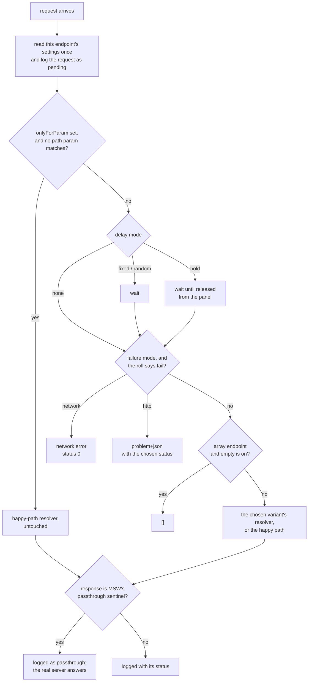

# mock-control

Runtime-configurable [MSW](https://mswjs.io) mocks, and a panel to change them
while the app runs: slow an endpoint down, fail it, empty it, hold a request until
you let it go, or swap in a different response. Settings survive a reload.

Built so a room can watch a page misbehave on purpose: what does this screen do
when the reviews service takes three seconds? When the holds request fails? When two
responses arrive out of order?

Imported in this workspace as `mock-control`, through `tsconfig` paths to source.

## Two halves

- **`core/`: framework-free.** `configurable()`, the store, the presets. MSW handlers
  run in the page (the service worker only forwards requests), so they read the store
  directly. No Angular imports here, ever.
- **`panel/`: Angular.** `<app-mock-panel />` (the "Mocks" button, bottom left) and
  `MockControl`, the store exposed as signals.

## What `configurable()` does with a request

The resolver you write is the happy path. Everything else is applied around it, in
this order:



Settings are read once, at the start, so changing them mid-request doesn't affect a
request already in flight.

## Using it

### A mocked endpoint

```ts
import { configurable } from 'mock-control';

export const handlers = [
  configurable(
    { id: 'catalog.title', label: 'Catalog: title', method: 'GET', path: `${catalog}/titles/:id` },
    ({ params }) => HttpResponse.json(findTitle(params['id'])),
  ),
];
```

- **`id`** is the key settings are saved under. Keep it stable.
- **`returnsArray: true`** offers "return an empty array" in the panel.
- A third argument, **`variants`**, offers named alternative responses:

```ts
configurable(
  {
    id: 'api.branches',
    label: 'Branches',
    method: 'GET',
    path: `${api}/branches`,
    returnsArray: true,
  },
  () => passthrough(),
  { thousand: { label: '1,000 branches', resolve: () => HttpResponse.json(manyBranches) } },
);
```

### A real endpoint, still controllable

Return MSW's `passthrough()` from the resolver, and the real server answers, but the
panel can still delay or fail the request first. The log shows it as `passthrough`
(not the 302 sentinel MSW uses internally), with no duration, since the time is the
real server's.

**Mocks are for things you only read; things that remember are a real API.** An
endpoint whose data the app changes gets a pass-through entry, not a mock.

### Wiring it into an app

```ts
// mocks/browser.ts
export const worker = setupWorker(...handlers);
const preset = new URLSearchParams(location.search).get('mock');
if (preset) mockStore.applyPreset(preset); // ?mock=flaky: a link that sets the scenario

// main.ts: start the worker (dev only) before bootstrapping
await worker.start({ quiet: true, onUnhandledRequest: 'bypass' });

// app.ts template
<app-mock-panel />
```

## The panel

| Setting           | Effect                                                                                       |
| ----------------- | -------------------------------------------------------------------------------------------- |
| Response          | The default, or a named variant                                                              |
| Delay             | None, fixed, random (min–max: responses arrive out of order), or **hold** (released by hand) |
| Failure           | HTTP (a status, as problem+json) or network (status 0), at a rate from 0–100%                |
| Empty array       | Array endpoints return `[]`                                                                  |
| Only when param = | Apply the settings only when a path param equals this value (e.g. only title `1001`)         |

**Presets** set every endpoint at once and keep each one's chosen variant: Happy
path, Slow network (2 s), Out of order (200–3000 ms), Flaky (30% 503s), Server down
(500s), Offline (network errors), Empty lists.

The **request log** shows the last 100 requests: endpoint, variant, status, duration,
outcome. Held requests can be released from it.

## Where settings live

`localStorage['mock-control:v1']`: `{ configs, activePreset }`. Per browser, per
origin. A saved variant that no longer exists falls back to the default. To reset
from a test or a console: remove the key and reload.

## Known limits (measured, msw 2.15, Chrome)

- **MSW never sees a client abort.** When Angular cancels a request, the page's fetch
  rejects, but the mock's request signal never fires. So the panel can't show
  cancellation, and a held request whose client gave up stays "held." The `aborted`
  outcome exists in the code and, as far as we've seen, never happens. Showing
  cancellation needs a real API.
- **MSW stops mocking in a long-hidden tab.** The worker loses its client list when
  Chrome stops it, and everything goes to the real network ("Failed to fetch" for
  the made-up origins). Reload the tab.

## Not yet

- **Scenarios scoped to a route** ("this page's reviews are slow"): today settings
  are per endpoint, app-wide.
- **Macros**: a named sequence of settings for a lab step ("make holds fail, then
  recover").
