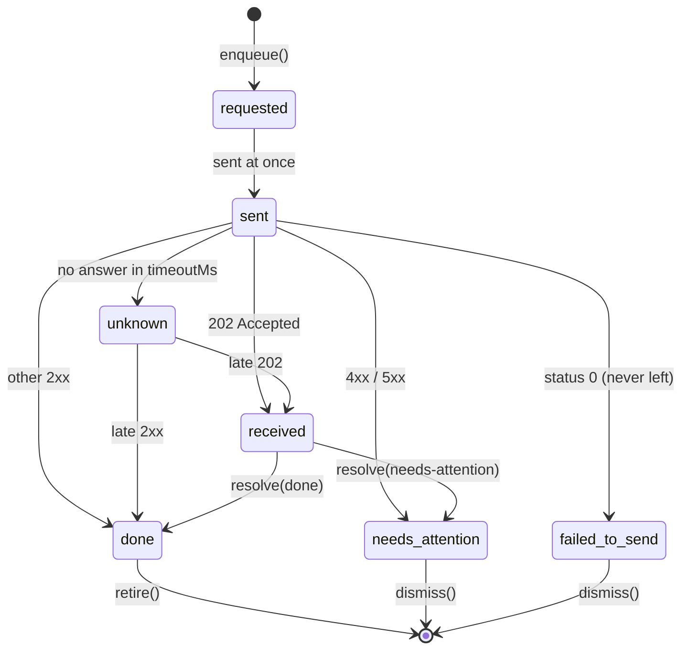
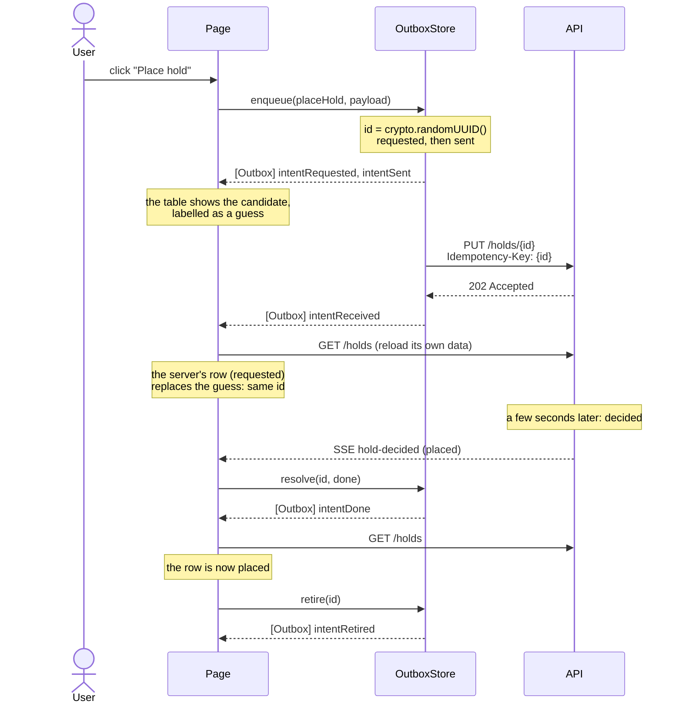

# outbox

A browser outbox for Angular: it holds what the user **asked for** (intents), sends
each one, and walks it through an honest lifecycle, so the screen can always say
something true. It owns the guesses, never the app's data.

Built on NgRx Signal Store (`@ngrx/signals`, entities, and events). Imported in this
workspace as `outbox`, through `tsconfig` paths to source. The ideas behind it, briefly,
are in the course notes (`outbox.md`). This file is how to use it.

**Phase 1: in memory.** A reload forgets every intent. See [Not yet](#not-yet).

## The idea in four words

| Word          | Means                                                                         | In code                                             |
| ------------- | ----------------------------------------------------------------------------- | --------------------------------------------------- |
| **Intent**    | What the user asked for, as a message with its own id. A request, not a fact. | `Intent` (plain data)                               |
| **Receipt**   | What's true the moment it's asked: "We've received your request…"             | `receipt()` on the type; `store.receipts()`         |
| **Candidate** | A guess at what the intent will become, kept _apart_ from the server's data.  | `candidate()` on the type; `store.candidates(type)` |
| **Apology**   | What the user is told when the guess didn't hold, or might not have.          | `apology` on the type; `store.apologies()`          |

And one act: **promotion**. When the server's version arrives in the feature's own
data, the guess has done its job, and the feature **retires** the intent. Nothing
edits the server's data to "make it look right."

## Lifecycle



| State             | What's true                                                              | Receipt | Candidate          | Apology  |
| ----------------- | ------------------------------------------------------------------------ | ------- | ------------------ | -------- |
| `requested`       | It's held here. Nothing has left.                                        | yes     | yes                |          |
| `sent`            | It left. We don't know if it arrived.                                    | yes     | yes                |          |
| `unknown`         | No answer in time. It **may have landed**. Not a failure.                | yes     | yes                | timeout  |
| `received`        | The server has it (202). The outcome is later. **Received is not done.** | yes     | yes                |          |
| `done`            | The outcome is known and good.                                           | yes     | yes, until retired |          |
| `needs-attention` | The outcome is known and bad.                                            | yes     | no                 | rejected |
| `failed-to-send`  | As far as we can tell, it never reached the server.                      | yes     | no                 | network  |

**A decision is final.** `done` and `needs-attention` never move again, except out
(retire, dismiss). Answers can arrive in any order (the PUT's own answer, a status
check, a server event), and a late one must not undo what's known.

## How a hold moves through it

The reference app's outbox page (`projects/reference/src/app/areas/holds/outbox/`), against the real
API. Rung three (server-sent events) shown; rungs one and two ask with
`GET /holds/{id}` instead, and end the same way.



## Using it

### 1. Declare an intent type

Behavior lives on the type, registered in code. The intent itself is plain data.

```ts
import { defineIntentType } from 'outbox';

export const placeHold = defineIntentType<PlaceHoldPayload, Hold>({
  name: 'place-hold', // stored on every intent; keep it stable across deploys
  request: ({ id, payload }) => ({
    method: 'PUT',
    url: `${API_URL}/holds/${id}`, // the intent's id is the resource's id
    body: { titleId: payload.titleId, branchCode: payload.branchCode },
  }),
  receipt: ({ payload }) => `We've received your request to place a hold on ${payload.titleName}.`,
  candidate: ({ id, payload }) => ({ id, titleId: payload.titleId, status: 'requested' }),
  apology: {
    say: ({ payload }, failure) =>
      failure.kind === 'timeout'
        ? `We're not sure your hold on ${payload.titleName} went through. We're still checking.`
        : `We couldn't place your hold on ${payload.titleName}: ${failure.detail ?? 'please try again.'}`,
    actions: ['retry'],
  },
  timeoutMs: 10_000, // default 30 s
});
```

**If you can't write the apology, you haven't earned the candidate.** `candidate` is
optional; `receipt` and `apology` are not.

### 2. Register it, app-wide

```ts
// app.config.ts
providers: [provideHttpClient(), provideIntentTypes(placeHold)];
```

In the application's providers, not a route's: an intent outlives the page that made
it. `enqueue` throws for an unregistered type.

### 3. Command in

```ts
const outbox = inject(OutboxStore);
outbox.enqueue(placeHold, { titleId, titleName, branchCode });
```

**The outbox sends every intent it's given.** Preventing a double submit is the
page's job, and a disabled button isn't enough (a second click can arrive before the
re-render). Check a signal in the handler:

```ts
protected place() {
  if (this.sending()) return; // computed over this page's intents: requested or sent
  this.outbox.enqueue(placeHold, { ... });
}
```

### 4. Events out

Every transition is a global event carrying the intent. The outbox doesn't know who
listens.

```ts
inject(Events)
  .on(outboxEvents.intentReceived, outboxEvents.intentDone, outboxEvents.intentNeedsAttention)
  .pipe(takeUntilDestroyed())
  .subscribe(() => this.myHolds.reload()); // the page decides what it means for its data
```

### 5. Hearing about "done"

A `received` intent waits for an outcome the outbox can't see. The app finds out
however it can, and calls `resolve`:

```ts
outbox.resolve(id, { status: 'done' });
outbox.resolve(id, { status: 'needs-attention', failure: { kind: 'rejected', detail: reason } });
```

The reference app has three rungs, each added on top of the last: a "Check status" button, a
check when the user comes back to the tab, and server-sent events. All three end in
the same `resolve`.

### 6. Show memory and guesses together, then promote

```ts
protected readonly rows = computed(() =>
  mergeWithCandidates(this.myHolds.value(), this.outbox.candidates(placeHold), (h) => h.id),
);
```

Candidates come first and drop out the moment memory has their id, so the guess and
the real row never both show. `isCandidate(row)` tells them apart in a template.

```ts
effect(() => {
  const done = this.myIntents()
    .filter((i) => i.state.status === 'done')
    .map((i) => i.id);
  const ready = readyToRetire(done, this.myHolds.value(), (h) => h.id);
  untracked(() => ready.forEach((id) => this.outbox.retire(id)));
});
```

## Reference

### `OutboxStore` (root signal store)

| Member                      | What it does                                                                                     |
| --------------------------- | ------------------------------------------------------------------------------------------------ |
| `enqueue(type, payload)`    | Creates the intent (new id), publishes `intentRequested`, sends it. Returns the intent.          |
| `resolve(id, outcome)`      | Records an outcome learned some other way. Ignored for unknown ids and decided intents.          |
| `retire(id)`                | Promotion: removes the intent, publishes `intentRetired`.                                        |
| `dismiss(id)`               | The user let it go: removes the intent, publishes `intentDismissed`.                             |
| `entities()`, `entityMap()` | Every intent still held (from `withEntities`).                                                   |
| `receipts()`                | `{ intentId, status, text }` for every intent held. Always true.                                 |
| `apologies()`               | `{ intentId, status, message, actions }` for `unknown`, `needs-attention`, and `failed-to-send`. |
| `candidates(type)`          | `Candidate<T>[]` for that type, except failed ones.                                              |

### Sending

- One `HttpClient.request` per intent, with `Idempotency-Key: {intent.id}` and the
  type's method, url, and body. (Only `POST`, `PUT`, `PATCH`, `DELETE`.)
- **202** → `received`. **Any other 2xx** → `done`.
- **Status 0** → `failed-to-send` (`network`). **Any other error** → `needs-attention`
  (`rejected`, with the HTTP status and a problem+json `detail` if the body has one).
- **No answer in `timeoutMs`** → `unknown`. The request is **not** cancelled: a late
  answer still lands, unless the intent was decided some other way meanwhile.

### Events (`outboxEvents`, source `Outbox`)

`[Outbox] intentRequested`, `intentSent`, `intentReceived`, `intentDone`,
`intentUnknown`, `intentNeedsAttention`, `intentFailedToSend`, `intentRetired`,
`intentDismissed`. Each carries `{ intent }`.

### Promotion helpers

- `mergeWithCandidates(memory, candidates, idOf)`: memory plus the candidates not yet
  in it, candidates first. Never edits memory.
- `readyToRetire(doneIds, memory, idOf)`: which decided intents memory now contains.
- `isCandidate(item)`: narrows `T | Candidate<T>`.

### Types

`Intent`, `IntentState`, `IntentStatus`, `Failure`, `Candidate`, `IntentType`,
`IntentRequest`, `Apology`, `ApologyAction`, `Receipt`, `ApologyNotice`,
`defineIntentType`, `provideIntentTypes`. See `src/lib/types.ts`.

## Rules the library keeps

- **Intents are plain, serializable data.** No functions, classes, or `Date`s
  (timestamps are epoch ms), and a `schema` version, so a later phase can store them.
- **Behavior is registered, never stored.** A stored intent names its type.
- **The intent's id is the idempotency key, and the real item's id.** That's what
  makes "has the server's version arrived?" an exact check.
- **It never writes the app's data.** Features read their data from their own
  resources, and guesses from here.
- **A decision is final.**

## Not yet

Phase 1 is in memory and deliberately small. Not built:

- **Durability.** A reload forgets every intent. (Later: IndexedDB, written in the
  same transaction as the candidate, and found again at startup.)
- **Retry.** An apology's `actions` are declared, but nothing performs them. A retry
  after a decision will be a _new_ intent; reusing the id is only for an outcome
  never known.
- **Ordering between intents.** Every intent is sent at once (`mergeMap`). Per-type
  `concatMap` is a proposal in the design.
- **Stale intents** (`staleAfter`): re-confirming an intent that waited too long.
- **Polling.** The outbox never asks about a `received` intent; the app does.

## Tests

```bash
npx ng test outbox --watch=false
```
